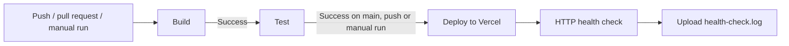
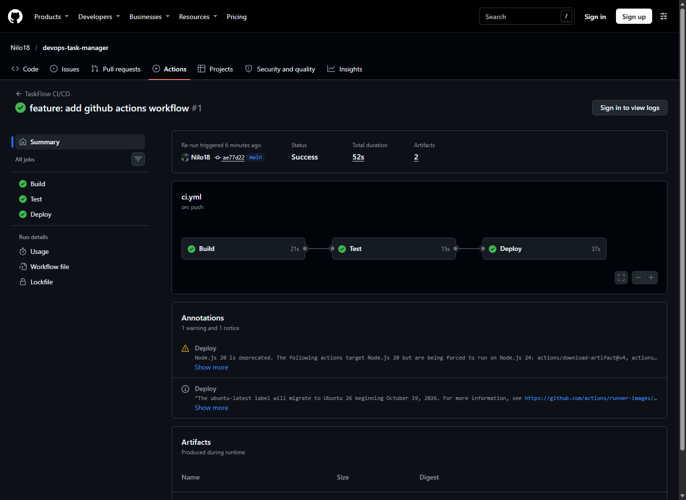
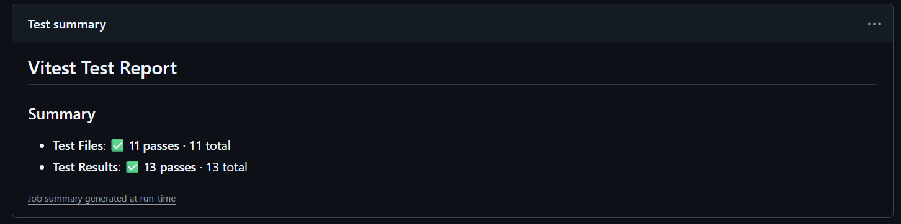
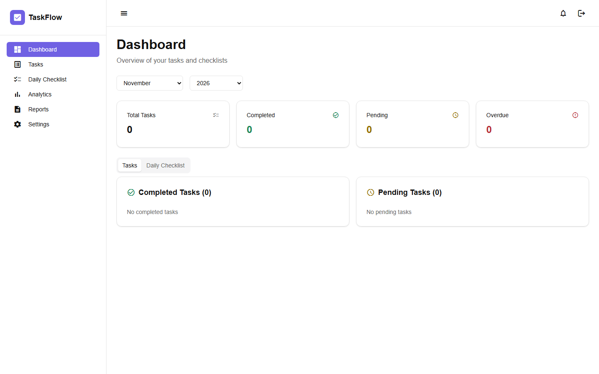

# TaskFlow

TaskFlow არის ამოცანებისა და ყოველდღიური ჩეკლისტების მართვის ვებაპლიკაცია. მომხმარებელს შეუძლია დაამატოს ამოცანები პრიორიტეტითა და ვადით, მონიშნოს შესრულებული პუნქტები, ნახოს შესრულების სტატისტიკა და შეინახოს ანგარიშები. მონაცემები ინახება ბრაუზერის `localStorage`-ში.

**ტექნოლოგიები** · Angular 21, TypeScript, SCSS, Angular Material, Vitest, GitHub Actions და Vercel.

## ლოკალურად გაშვება

საჭიროა Node.js 24 და npm.

```bash
npm ci
npm start
```

აპლიკაცია გაიხსნება მისამართზე `http://localhost:4200/`. ტესტების გასაშვებად გამოიყენეთ `npm test -- --watch=false`, ხოლო production ბილდისთვის — `npm run build`.

## Git და CI/CD

კოდი ინახება GitHub-ზე. `dev` გამოიყენება განვითარებისთვის, ხოლო `main` არის production დეპლოიმენტის ბრენჩი. [GitHub-ის ბრენჩები](https://github.com/Nilo18/devops-task-manager/branches)

[Workflow](.github/workflows/ci.yml) ავტომატურად იწყება ყოველ push-სა და pull request-ზე. შესაძლებელია მისი ხელით გაშვებაც.

| ეტაპი | რას აკეთებს |
| --- | --- |
| **Build** | აყენებს დამოკიდებულებებს `npm ci`-ით, ქმნის Angular-ის production ბილდს და ტვირთავს მას `taskflow-browser` არტეფაქტად. |
| **Test** | წარმატებული ბილდის შემდეგ უშვებს Vitest-ის ტესტებს. ტესტები ამოწმებს, მათ შორის, შესრულებული და ვადაგადაცილებული ამოცანების დათვლას. |
| **Deploy** | წარმატებული ტესტების შემდეგ, `main`-ზე push-ის ან ხელით გაშვებისას, ჩამოტვირთავს ბილდს და Vercel CLI-ით აქვეყნებს production გარემოში. |

დეპლოიმენტისთვის GitHub Actions იყენებს რეპოზიტორიის სამ საიდუმლო მნიშვნელობას: `VERCEL_TOKEN`, `VERCEL_ORG_ID` და `VERCEL_PROJECT_ID`.

### სამუშაო პროცესის დიაგრამა



## მონიტორინგი და ჯანმრთელობის შემოწმება

Deploy ეტაპი `curl`-ით ამოწმებს Vercel-ის მიერ დაბრუნებულ URL-ს. `health-check.log` შეიცავს UTC დროს, URL-ს, HTTP სტატუსსა და `curl`-ის გამოსვლის კოდს. შემოწმება წარმატებულია, როდესაც HTTP სტატუსი არის `2xx` და გამოსვლის კოდი არის `0`. ლოგი ინახება `deployment-health` არტეფაქტში. მისი ნახვა შეიძლება workflow-ის **Summary → Artifacts** განყოფილებაში ან **Deploy → Check deployment health** ეტაპის ლოგში. [GitHub Actions-ის გაშვება](https://github.com/Nilo18/devops-task-manager/actions/runs/41660119562)

## შესრულების მტკიცებულებები

### წარმატებული CI/CD პაიპლაინი

GitHub Actions-ზე `main` ბრენჩისთვის სამივე ეტაპი წარმატებით დასრულდა.



### წარმატებული იუნიტ ტესტები

Vitest-ის ანგარიშში ჩანს 11 წარმატებული სატესტო ფაილი და 13 წარმატებული ტესტი.



### მომუშავე აპლიკაცია

TaskFlow-ის დეშბორდი ლოკალურად გაშვებულ აპლიკაციაში.


